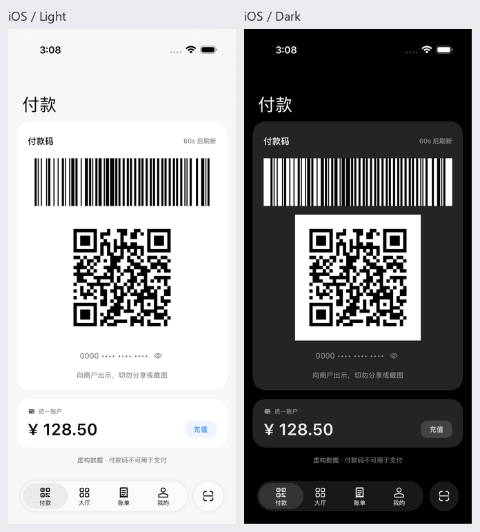

# 第一轮 Kotlin / iOS 迁移验证

验证基线来自原 Android 仓库的 `5697ed0`。迁移工程独立位于 `migration/`，
使用 Kotlin `2.4.21`、Compose Multiplatform `1.12.2` 和 Maven Central 的 Miuix `0.9.5-beta01`。
2026-11-19，迁移实现提交 `9a9cda2` 的 [完整 CI 验证](https://github.com/Mercury000/HUEL-yktwx-kmp/actions/runs/44547234298)
成功完成共享层测试、iOS framework 编译和模拟器 UI 测试。

## 已验证的共享逻辑

原源码在构建时直接进入 KMP 共享模块；唯一平台替换是一处 JVM 时钟调用。
测试入口由 JUnit 转为 `kotlin.test`，业务断言保持原样。

| 原测试组 | JVM | iOS 模拟器 | 覆盖范围 |
| --- | ---: | ---: | --- |
| KeyboardEncoderTest | 6 / 6 | 6 / 6 | 字符映射、非法输入、UUID 校验、敏感字段隐藏、付款码展示周期 |
| ReadGateTest | 12 / 12 | 12 / 12 | 可见性、网络状态、单请求、重试预算与恢复 |
| ReadControllerTest | 20 / 20 | 20 / 20 | 前后台恢复、取消、迟到结果、共享读取调度 |
| 合计 | **38 / 38** | **38 / 38** | **零失败、零跳过** |

上述数量已从本次成功运行上传的 JVM / iOS HTML 测试报告核对。

## UI 验证范围

复用原 `BarBlur.kt`、`AppIcons.kt`、`PaymentCodeNumber.kt`，并抽取原玻璃宿主、
顶部栏、按钮、弹窗和付款布局测量代码。付款正常状态布局使用虚构数据，
导航使用原 OS4 的 Miuix 玻璃组件与图标。
原充值按钮的 32dp 高度、12dp 圆角、13sp 字体和主题色通过源码抽取复用。
手机悬浮导航模式只在底部保留扫码入口；iOS 深色切换同步 UIKit 窗口样式。

beta01 与原快照存在顶部栏 API 可见性差异：`BlurTopAppBar` 在 beta01 中为内部 API。
验证宿主的导航标题透明度固定为 1，因此抽取时将其零模糊降级分支映射为公开的 `TopAppBar`。
原玻璃顶部栏分支与原 Android 文件保持原样；平板侧栏标题动画不在本阶段验证范围内。

beta01 的 iOS 导航无障碍标签会合并图标描述与文字，例如“我的, 我的”。
模拟器 UI 测试通过标签前缀选择按钮，并检查实际目标页面，兼容唯一标签和合并标签。

Xcode 在 **iPhone Air / iOS 26.5 / arm64 模拟器**上构建并启动了验证 App。
`MigrationUITests.testPaymentAndGlassDialog` 的完整交互流程通过，Xcode 返回 `TEST SUCCEEDED`。
这是一个 UI 测试流程，包含以下检查点：

| 检查点 | 结果 | 截图 |
| --- | --- | --- |
| 付款页标题和虚构余额正确显示 | 通过 | [浅色付款页](images/migration/ios-payment-light.png) |
| 充值按钮打开原玻璃弹窗，关闭按钮恢复页面 | 通过 | [充值弹窗](images/migration/ios-recharge-glass-dialog.png) |
| “我的”导航进入应用设置 | 通过 | [设置页](images/migration/ios-settings-light.png) |
| 深色开关生效，返回付款页成功 | 通过 | [深色付款页](images/migration/ios-payment-dark.png) |

浅色、深色付款页、充值弹窗和设置页四张截图已人工查看，未见明显裁切或资源缺失。
系统状态栏和充值按钮的颜色跟随深色模式，原付款布局及 OS4 导航正常显示。
截图是本次 iOS 模拟器的实际输出，使用虚构二维码与余额。

## 结论的边界

- 已证明这部分 Kotlin 业务规则能在 JVM 和 Kotlin/Native iOS 上共用。
- 此 App 是局部 UI 验证，未连接真实账户或业务网络，也不发起真实支付。
- 虚构二维码使用 `example.invalid`，条形码带 `DEMO` 标记。
- 相机扫码、支付宝/银联、Keychain、前后台付款码清理与截图监听尚未实现。
- 尚未完成全页面视觉对齐、字体缩放、系统手势和真机性能验证。

## 无苹果设备与费用

日常 Kotlin 编辑、共享层 JVM 测试和桌面预览可在 Windows 上进行。
iOS 编译与模拟器运行由此公开仓库的标准 GitHub macOS runner 完成，
本轮未使用苹果实机，也不需要 Apple Developer Program 账号。
模拟器构建可验证界面和公共逻辑，但不能代替相机、支付 SDK、硬件与真机性能验证，
其 App 产物也不能直接安装在 iPhone 上。

公开仓库的标准 GitHub Actions runner 和 Maven Central 依赖可免费使用。
私有仓库的 CI 配额、苹果实机以及正式上架所需的开发者会员费用应单独考虑。
CI 适合编译与回归截图；它提供不了 Windows 本地的交互式 iOS 模拟器开发体验。

## 后续迁移判断

iOS 可以继续沿用 Kotlin、Compose 和 Miuix，保留已有布局及组件实现，
再逐项适配平台能力。本阶段只覆盖付款正常状态和部分组件，
全页面保持原 UI 的结论仍需后续验证。

运行方式与合并策略见 [迁移工程说明](../migration/README.md)。
